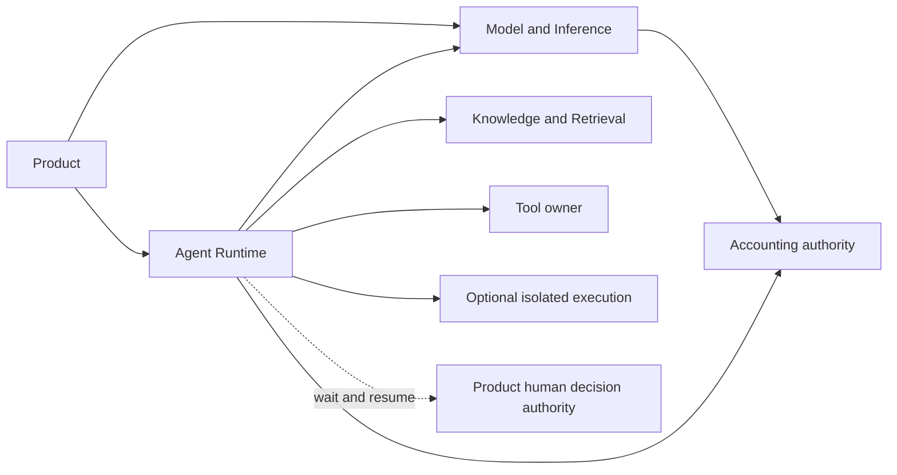

# Agent Runtime alignment: proposed system design

**Date:** 22 October 2026 (Asia/Jakarta). **Status:** draft proposal for discussion. Preparing or merging this document does not adopt its choices, approve production, or change SAD-020's chartered status.

## Purpose and reading order

Propose a durable Agent Runtime that consumes Model & Inference through an explicit contract, while preserving the existing M0–M2 implementation and useful M3 infrastructure. The first user-visible target is one versioned agent executing two model turns around one authorized read-only Tool, retaining its progress across a coordinator restart.

Read the [source comparison](../reviews/SCNEHAUX-ARCHITECTURE-ALIGNMENT.md), this system design, the [technical design and test-first plan](AGENT-RUNTIME-TDD.md), then the [transition roadmap](AGENT-RUNTIME-TRANSITION.md). Current behavior remains documented in [CURRENT-STATE](../implementation/CURRENT-STATE.md) and the [active HTTP catalogue](../implementation/HTTP-API.md).

The governing Scnehaux checkout inspected for this proposal is `52a7d1d18f9235c64d6e8a89bee17d3dade728e9`. Source paths and recorded statuses are in the comparison. ADR-GLB-015 is accepted; PAD-PLT-008 and PAD-PLT-016 are approved; SAD-011 and SAD-020 are chartered. This local proposal is input to the downstream design process, not a replacement for those documents.

## Proposed responsibility boundaries

| Authority                     | Owns                                                                                                                                         | Consumes or delegates                                                              | Does not own                                                                                      |
| ----------------------------- | -------------------------------------------------------------------------------------------------------------------------------------------- | ---------------------------------------------------------------------------------- | ------------------------------------------------------------------------------------------------- |
| Product/application           | Business workflow, domain prompts/skills, outcome acceptance, domain authorization                                                           | Agent runs or direct inference                                                     | Platform ledger or another Product's resources                                                    |
| Model & Inference             | Capability Profiles, model/provider routing, bounded inference lifecycle, provider health and usage facts                                    | Trust, accounting, telemetry                                                       | Agent Definition, Run/Turn, memory, Tool mediation                                                |
| Agent Runtime                 | Definition runtime version, Run/Turn, Harness state, bounded context/memory, Tool binding, budget/stop control, waits and delegation lineage | Model & Inference, Knowledge, Tool owners, accounting, optional isolated execution | Provider routing, Product outcomes, Knowledge truth, Tool operation truth, human approval meaning |
| Tool owner                    | Protected operation authorization, business invariants, deduplication/status and committed effects                                           | Validated caller/delegation context                                                | Agent progress or authority to extend a run's grants                                              |
| Accounting authority          | Account holds, accepted usage charges, adjustments and release                                                                               | Canonical inference/Tool/compute evidence                                          | Declaring agent success or Product acceptance                                                     |
| Isolated execution capability | Scoped compute lifecycle, containment, local stop observations                                                                               | Approved image, scoped data and capability grants                                  | Agent reasoning, domain workflow, provider settlement or permission expansion                     |

Product authority separation does not by itself require separate repositories, databases or network calls. The proposed initial packaging is one monorepo with distinct module owners and ports. The existing API process may host trusted coordinator use cases. Arbitrary plugin code stays outside the API process; isolated workers keep their own lifecycle. Independent deployment can follow measured scaling, security or release needs.

These are proposed authority dependencies. They are not a diagram of implemented services. Accounting calls from both products reference canonical charge identities; parent aggregation is not a second charge.

## Proposed architecture choices

All entries below are recommendations awaiting disposition. None is an adopted ADR.

| ID     | Recommendation                                                                                         | Reason and constraint                                                                                                                                                   |
| ------ | ------------------------------------------------------------------------------------------------------ | ----------------------------------------------------------------------------------------------------------------------------------------------------------------------- |
| AR-P01 | Explicit Model & Inference and Agent Runtime modules in the current monorepo                           | Reuse M2 without a new distributed boundary for every model call; enforce ownership/import rules before claiming separation.                                            |
| AR-P02 | Durable Agent Definition/Run/Turn records distinct from generic Execution/Attempt                      | Worker ownership is not agent progress. Keep old identifiers and APIs compatible through explicit links.                                                                |
| AR-P03 | PostgreSQL discrete state transitions and transactional outbox, extending existing repository patterns | No network call inside a database transaction; no new workflow engine or broker assumption. Redis remains lease/presence/replay infrastructure.                         |
| AR-P04 | Agent Runtime uses a model-execution port backed initially by M2                                       | No provider SDK types or credentials in the agent domain. A runtime adapter must demonstrate mediation rather than bypass routing/budget policy.                        |
| AR-P05 | Whole-run financial reservation with internal child allocations                                        | Model turns consume the same reserved exposure; they do not independently reserve that amount again. Requires an accounting extension before paid multi-turn execution. |
| AR-P06 | Resume committed progress; reconcile every ambiguous dispatched operation before further work          | Same intent is not a retry permit. No new provider/Tool call merely because a coordinator or lease disappeared.                                                         |
| AR-P07 | Treat sandbox as an optional execution adapter                                                         | Retain runsc evidence and candidate status. Profiles needing code execution remain unavailable until their affected security/runtime gates pass.                        |
| AR-P08 | First slice uses serial turns and an allow-listed read-only Tool                                       | Prove useful durable behavior before concurrency, child runs, arbitrary packaged scripts or human approval integration. Unsupported requirements fail admission.        |

These choices reuse the local stack without asserting that Scnehaux has selected it for SAD-020. ADR-GLB-015's authority split is the source requirement; this table proposes a physical realization.

## Proposed logical components and dependency rules

| Component                  | Responsibilities                                                                                       | Boundary rule                                                                                                            |
| -------------------------- | ------------------------------------------------------------------------------------------------------ | ------------------------------------------------------------------------------------------------------------------------ |
| Definition registry        | Immutable approved version references, compatibility, schemas, bindings and control limits             | Product retains semantic acceptance of its assets; package signature alone does not approve a definition.                |
| Agent coordinator          | Admission, discrete state transitions, cancel intent, continuation scheduling and fenced result commit | Depends on ports; never imports provider adapters or runs arbitrary plugin code.                                         |
| Trusted Harness adapter    | Interpret a supported runtime's proposals and execute permitted turns/Tools                            | SDK/runtime output is untrusted input to policy; every new external dispatch passes authority, grants and budget checks. |
| Context service            | Assemble bounded authorized inputs and references; retain a permitted checkpoint                       | Does not become a Knowledge source or retain secrets in memory/checkpoints.                                              |
| Tool mediation             | Validate binding/schema/authority; retain intent and reconcile external status                         | Tool owner re-authorizes protected operations; existing ToolEffect is a reuse candidate.                                 |
| Model-execution adapter    | Translate a stable capability request to M2 and expose durable status/result/usage references          | M2 has no dependency on agent implementation or tables. Lineage is caller context, not authority to change a run.        |
| Isolated-execution adapter | Bind a compute request to exact assignment, allowed inputs and containment policy                      | Existing driver/host are candidates; no caller host paths, broad secrets or arbitrary host sockets.                      |

The future dependency gate must reject Model & Inference imports of agent domain/application modules, agent domain imports of provider SDK/infrastructure, and another module's direct writes to owned tables. A composition root may wire adapters. Shared authentication/telemetry/accounting contracts must not become a generic module containing every product's mutable state.

## Identity, data and authority

An Agent Definition/version is a runtime contract, an Agent Run is one durable invocation, an Agent Turn is a model interaction, and an execution Attempt is an infrastructure ownership episode. They have different identities and lifetimes. Restarting a coordinator does not create a new Run; replacing a worker does not automatically authorize the next Turn.

Every Run carries application, Tenant, initiating principal/workload, pinned Definition/version and runtime release, input identity, authorized scopes and delegation source. Current local application scope is useful but is not proof of complete Tenant/delegation enforcement. The new public surface must obtain those claims from trusted identity policy, never accept an authoritative Tenant from an input body, and fail admission when required identity is unavailable.

| Proposed record        | Writer                                         | Essential references and facts                                                                                                                                |
| ---------------------- | ---------------------------------------------- | ------------------------------------------------------------------------------------------------------------------------------------------------------------- |
| AgentDefinitionVersion | Definition use cases                           | Application/Tenant, immutable version/digest, capability requirements, Tool/context/memory bindings, policy limits, semantic approval reference and lifecycle |
| AgentRun               | Agent coordinator                              | Pinned version, caller/delegation scope, input reference/digest, lifecycle/revision, cancel intent, stop reason, budget and optional legacy execution link    |
| AgentTurn              | Agent coordinator                              | Run/sequence, prepared context reference, model intent, inference reference, immutable input identity and accepted output reference                           |
| AgentOperation         | Agent coordinator                              | Run/Turn, kind, stable intent ID, request digest, state, grant/budget allocation reference and external receipt/status reference                              |
| AgentWait              | Agent coordinator                              | Run/revision, reason, bound operation or authenticated decision request, expiry and one-time resume identity                                                  |
| AgentCheckpoint        | Context/checkpoint service through coordinator | Run/revision/runtime signature, authorized encrypted content/reference, digest and retention class; no provider keys or serialized arbitrary process memory   |
| AgentEvent and outbox  | Same transaction as state writer               | Run/revision/sequence, event type and sanitized reference payload; duplicate delivery cannot duplicate a transition                                           |

Proposed tables are additive and have one designated writer. Exact names, schema placement, keys, limits and transaction predicates are specified in the companion technical proposal. No migration is included here. Existing Execution/Attempt/ProfileRevision are not renamed or silently assigned new semantics.

## Lifecycle and recovery

Proposed Run lifecycle: `CREATED -> RUNNING -> WAITING_TOOL | WAITING_HUMAN | SUSPENDED -> RUNNING -> COMPLETED`. Terminal alternatives are `CANCELLED`, `FAILED` and `STOPPED_BUDGET`. `stopReason` and pending external/financial reconciliation are separate facts. Exact wire enums are prospective and do not extend today's ExecutionStatus.

The first slice supports Tool waiting and recovery suspension. Human waits, persistent Session Memory, delegation and child runs are future features with admission rejection until supported. Waiting on a human is not permission to infer approval. A definition requiring an unsupported feature must not silently run without it.

Before dispatch, persist the operation intent and allocation. Mark the dispatch boundary durably before the external call. After a response, persist the accepted receipt/output and the next progress checkpoint under the current Run revision and infrastructure authority. A crash after remote acceptance but before local commit leaves an ambiguous operation; restart performs status/reconciliation on that same operation rather than creating another.

For the first slice, automatic progress recovery is allowed only after a checkpoint is durable, all prior operations are resolved, and existing worker authority permits execution. Recovery with a prior live/uncertain sandbox or dispatched unknown operation remains suspended. This proposal does not enable autonomous worker reassignment, stale-lock takeover or native sandbox retirement. Those retain their own stop/effect proof gates.

Cancellation commits intent and closes the admission gate for new operations. Concurrent cancellation and operation admission serialize at the Run row/revision: an operation admitted first may already be in flight; one admitted after cancellation is rejected. Cancellation cannot erase earlier charges, undo a committed Tool effect or turn unknown into no effect. Late results and usage follow evidence intake, not renewed ownership.

Completion requires a validated durable result reference and no unresolved required operation. An Agent result remains a proposal to the Product. Completion does not wait for all billing reconciliation, and a terminal Run retains references to any remaining accounting/effect investigation.

## Budget and usage

The proposed first paid slice reserves a finite whole-run envelope through the existing accounting authority, then delegates bounded allocations to individual model turns. A child allocation is an internal subdivision of the existing hold, not another account debit/hold. M2 direct inference continues to use its existing independent admission path.

This needs a new authenticated allocated-inference admission capability. An ordinary caller cannot supply a parent reservation ID to skip admission. The accounting authority verifies application/Tenant, Run/operation identity, unit, allocation limit, expiration, revocation and one-use binding before a dispatch. Agent Runtime does not directly mutate financial tables. Current M2 admission cannot be treated as supporting this mode already.

Known settled usage consumes the bound allocation through canonical evidence identity once. Pending/unknown exposure stays allocated and held. Run/Turn summaries reference the same underlying charges and are never posted again. A verified overage is recorded even beyond the allowance, stops new allocations and enters reconciliation. No universal exact-dollar hard stop is promised for an opaque runtime or already in-flight provider call.

Limits also cover turn count, Tool calls, elapsed time, context bytes/tokens and result bytes. A profile may promise a hard bound only when the selected model/runtime/Tool adapter can enforce it; otherwise admission fails or the documented bound is explicitly an exposure estimate. Production unit/pricing/overage policy remains with O07/O13.

## Security, runtime and operational constraints

- Recheck caller/binding policy, authority, cancel state, capability and allocation before every new paid or mutating dispatch. Untrusted model/Tool text cannot create grants.
- Payload/checkpoint/artifact bytes use scoped encrypted storage and approved retention. Metadata, object keys, logs and traces contain sanitized references, not raw prompts, outputs, credentials or grant tokens.
- Run Memory is bounded execution continuity; Session Memory is separately scoped/versioned. Neither publishes Knowledge or Product master data implicitly.
- A Claude adapter is the first compatibility target from the local roadmap. It must prove mediated model/Tool dispatch and reconstructible progress; an opaque SDK that bypasses these controls is not accepted for that profile.
- No live provider, production KMS/signing, code execution or new endpoint becomes active from this proposal. Existing Linux VM/VPS preference and experimental runsc evidence remain deployment inputs, not O03 closure.
- Expose Run/Turn/operation/Inference IDs, stop reasons, stale-progress age, unknown-operation backlog, usage completeness and recovery outcomes. Preserve the existing no-raw-content trace policy and bounded/low-cardinality metric contract requirement.
- Proposed NFR acceptance must trace PAD-PLT-016 availability, durable Run RTO/RPO, bounded concurrency and security requirements to measured deployment evidence. This document does not claim those SLOs are achieved.

## Compatibility and alternatives

Existing `/v1/chat`, `/v1/generate`, `/v1/executions`, read/cancel/SSE behavior and generated contracts remain unchanged during design work. New agent operations would be additive and separately versioned. `agent_execute` remains unavailable through current production composition until activation gates pass. Compatibility does not mean fabricating Agent Runs for historical inference rows.

Alternatives considered: immediate repository/microservice extraction adds migration/network failure scope before authority is defined; continuing one combined domain hides the accepted product split; discarding the merged worker/gateway wastes useful tested components; an SDK-only wrapper cannot satisfy durable progress or mediated authority. The recommended approach isolates module authority, adds the missing agent domain, then earns further physical separation through evidence.

## Disposition required

Architecture review needs to resolve AR-P01–08, the local ADR reconciliation, and the route for proposing changes to chartered SAD-011/SAD-020. Security/identity, accounting and Product owners then review their respective contracts and pilot. User authorization to prepare this package does not supply those separate dispositions.

The [transition proposal](AGENT-RUNTIME-TRANSITION.md) defines entry/exit evidence and open choices. Implementation starts only within the subsequently authorized design scope; production requires the existing [reliability gate](../adr/0013-evolution-gates.md) and deployment-specific evidence.
